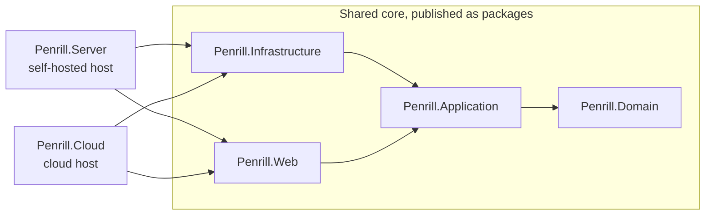
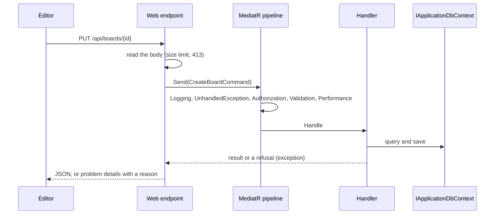

# Architecture

Penrill Server follows the [Clean Architecture solution template](https://github.com/jasontaylordev/CleanArchitecture)
(v11, .NET 10): Domain, Application, Infrastructure and Web layers, MediatR requests with pipeline behaviours,
FluentValidation, EF Core behind `IApplicationDbContext`, ASP.NET Core Identity, Aspire for local orchestration, and
NUnit with Shouldly and Moq for tests. MediatR is held at 12.5.0 and AutoMapper is not used, for licence and security
reasons ([ADR-008](decisions/ADR-008-Free-MediatR-And-AutoMapper.md)); queries project with `Select`.

The same core also runs Penrill Cloud. Domain, Application, Infrastructure, Web and the contract tests are published
as NuGet packages; this repository adds the self-hosted host on SQLite, and Penrill Cloud adds its host on PostgreSQL.
How a host builds on the core without changing it is in [EXTENDING.md](EXTENDING.md).

## Layers



Dependencies point inward only. Domain knows nothing else; Application knows Domain; Infrastructure and Web know
Application; a host composes all of them.

| Project | Package | What it holds |
|---|---|---|
| `src/Domain` | `Penrill.Domain` | Entities (`Board`, `BoardChange`, `Credential`, `Folder`, `Template` and the rest), enums (`Role`, `CredentialKind`, `GrantKind`), domain events, limits and rules (`BoardLimits`, `AccountRules`), and the board model in `Boards/`: the change format and its strict parser (`ChangeCodec`), `BoardDocument` that applies changes, `BoardContent` and `TemplateFile`. |
| `src/Application` | `Penrill.Application` | Use cases as MediatR requests, one folder per feature (`Accounts`, `Linking`, `Boards`, `Sharing`, `Templates`), the services several use cases and the host's own front ends share (`AccountService`, `GrantService`, `LinkService`, `AdminService`), live board rooms and the WebSocket protocol (`Live`), pipeline behaviours, and the interfaces Infrastructure implements. |
| `src/Infrastructure` | `Penrill.Infrastructure` | `ApplicationDbContext` (EF Core, provider-neutral) with its entity configurations, interceptors, ASP.NET Core Identity accounts (`IdentityService`) and the file asset store. The host chooses the database provider and the assembly that holds its migrations. |
| `src/Web` | `Penrill.Web` | Everything under `/api`: endpoint groups, the bearer session scheme, problem details, rate limits, CORS, Private Network Access and the WebSocket upgrade. |
| `src/Server` | | The self-hosted host: SQLite and its migrations, backups, the command line and interactive configurator, the server's own web pages under `/web`, LAN certificates, ACME and dynamic DNS. |
| `src/ServiceDefaults` | | OpenTelemetry (with the `Penrill` meter and activity source), health checks, service discovery and resilience. |
| `src/AppHost` | | Aspire app host for local development (`aspire run`). |
| `tests/Contract` | `Penrill.Contract.Tests` | The API contract editors rely on, as NUnit fixtures every host runs. |

## A request



- **Endpoints are thin.** An endpoint reads HTTP input, sends one request and turns the result into a response.
  Bodies that need a size limit (boards, changes, images, templates) are read by `Bodies` in Web before the request
  is sent.
- **Behaviours** run in this order: `LoggingBehaviour` (request name and user only, never the request, which can
  hold passwords or whole boards), `UnhandledExceptionBehaviour` (logs only unexpected failures),
  `AuthorizationBehaviour` (`[Authorize]` and `[Authorize(Policy = Policies.NoGuests)]`), `ValidationBehaviour`
  and `PerformanceBehaviour`.
- **Refusals are exceptions** from `Application/Common/Exceptions`, turned into RFC 9110 problem details by
  `ProblemDetailsExceptionHandler`: validation 400, `UnauthorizedAccessException` 401,
  `ForbiddenAccessException` 403, `NotFoundException` 404, `ConflictException` 409, `GoneException` 410,
  `PayloadTooLargeException` 413, `UnsupportedMediaTypeException` 415, `ServiceUnavailableException` 503.
  A refusal with a reason (`hash-mismatch`, `invalid`, `board-full`) carries it as a `reason` member, which editors read.

## Accounts and sign-in

- Accounts are ASP.NET Core Identity users (`ApplicationUser`). The user name is also the account id, so boards,
  folders and templates refer to people by name. Roles (`Guest`, `Member`, `Admin`, `Owner`) are Identity roles.
- Editors sign in with an opaque bearer token: 32 random bytes in hex. Only its SHA-256 is stored, in `Credential`.
  A session (from a password) lasts 30 days; a device token (from device linking or a draw link) lasts until revoked.
  `BearerSessionHandler` in Web authenticates requests with it.
- Signing out, revoking a device, disabling or deleting an account publishes `CredentialRevokedEvent`; the live
  connections that used the credential close.
- Device linking follows RFC 8628 (`LinkService`): requests live in memory for ten minutes.
- One-time links (`GrantService`) claim a fresh server, invite people and reset passwords.

## Boards and the live protocol

- A board is a snapshot of its items plus a log of the changes after it (`Board`, `BoardChange`). A change is a list
  of `put`, `patch`, `delete` and `meta` operations with an id the client chose; the id makes resending safe.
- `RoomRegistry` keeps one `BoardRoom` in memory per board in use. A room orders changes one at a time, writes each to
  the log through `BoardLog` (an optimistic check on the board's sequence number guards the order), broadcasts it,
  and writes a snapshot every 500 changes. Idle rooms are unloaded after two minutes by `RoomJanitor`.
- `LiveSessions` speaks the WebSocket protocol in [PROTOCOL.md](PROTOCOL.md): the hello frame authenticates, the room
  catches the client up with a delta or a snapshot, then submits, signals and pings flow. Web only accepts the socket.
- Who may open a board: its owner, members of a folder it is shared into, and people let onto it by name or by its
  draw link (`BoardAccessExtensions`). Losing access publishes `BoardAccessRevokedEvent`; deleting a board publishes
  `BoardDeletedEvent`. Their handlers in `Application/Live` close the affected connections.
- Images are stored once by SHA-256 (`IAssetStore`); `BoardAsset` records which boards use which images, and all images
  on one board together stay under 256 MiB.

## Domain events

Entities raise events with `AddDomainEvent`; `DispatchDomainEventsInterceptor` publishes them through MediatR **after**
the save succeeded, so handlers see the committed state. Bulk operations (`ExecuteDelete`, `ExecuteUpdate`) bypass the
change tracker, so their use cases publish events directly with `IPublisher`.

## Storage

- `ApplicationDbContext` is the same for every host. On SQLite, `DateTimeOffset` values are stored as UTC ticks so they
  can be compared and ordered in SQL; other providers use their own date types.
- The self-hosted server keeps `penrill.db` and an `assets` folder in its data directory (`PENRILL_DATA_DIR`). Its
  migrations live in `src/Server/Data/Migrations`; the server applies them on start.
- A backup (`IBackupWriter`, `SqliteBackupWriter`) is a zip of a `VACUUM INTO` copy of the database and the image files.

To add a migration after changing the model:

```sh
dotnet ef migrations add <Name> --project src/Server --startup-project src/Server --output-dir Data/Migrations
```

CI fails when the model and the migrations disagree.

## Telemetry

`ServiceDefaults` sets up OpenTelemetry logs, metrics and traces, exported over OTLP when
`OTEL_EXPORTER_OTLP_ENDPOINT` is set. The `Penrill` meter (`Application/Common/Telemetry/PenrillTelemetry.cs`)
counts accepted, duplicate and rejected changes, open rooms and live connections, catch-ups, snapshot sizes,
uploaded image bytes and refused sign-ins.

## Tests

| Project | What it covers |
|---|---|
| `tests/Domain.UnitTests` | The change format, applying changes, account rules. |
| `tests/Application.UnitTests` | Behaviours and problem details mapping. |
| `tests/Infrastructure.IntegrationTests` | Board rooms and their log on a real SQLite database. |
| `tests/Application.FunctionalTests` | The whole server through HTTP and WebSockets: the API contract, claims, invites, resets, administration and the `/web` pages. |
| `tests/Contract` | The contract fixtures themselves (not run on their own). |

```sh
dotnet test Penrill.slnx
```

## Decisions

The reasons behind these choices are in [decisions](decisions/README.md).
