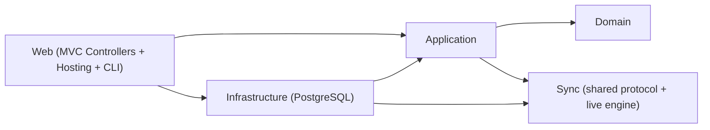

# Architecture

Penrill Server follows the Clean Architecture solution template (.NET 10, PostgreSQL): `Domain`, `Application`,
`Infrastructure` and `Web` layers, MediatR requests with pipeline behaviours, FluentValidation, EF Core behind
`IApplicationDbContext`, ASP.NET Core Identity (without IdentityServer), MVC Controllers (without Minimal APIs),
Aspire for local orchestration, and NUnit with Shouldly and Moq for tests. MediatR is held at 12.5.0 and AutoMapper
is not used ([ADR-008](decisions/ADR-008-Free-MediatR-And-AutoMapper.md)); queries project with `Select`.

Only the thin synchronization engine (`src/Sync`, namespace `Sync`) and the black-box editor contract suite
(`tests/Contract`, namespace `ContractTests`) are shared with Penrill Cloud via a pinned git submodule
([ADR-009](decisions/ADR-009-Thin-Sync-Core-Postgres-And-Controllers.md)).

## Layers



| Project | Namespace | What it holds |
|---|---|---|
| `src/Sync` | `Sync` | Shared board document model, change codec, dynamic `BoardLimitPolicy`, `BoardPermission`, `ServerCapabilities`, and pluggable live rooms (`BoardRoom`, `RoomRegistry`, `LiveSessions`) behind SPI interfaces (`IBoardStore`, `IBoardHistorySink`, `ILiveAuthenticator`, `ILiveAccessPolicy`, `ILiveEventObserver`, `IRoomBackplane`). |
| `src/Domain` | `Domain` | Self-hosted entities, enums, domain events and account rules. |
| `src/Application` | `Application` | MediatR CQRS use cases (`Accounts`, `Linking`, `Boards`, `Sharing`, `Templates`), shared services (`AccountService`, `GrantService`, `LinkService`, `AdminService`), pipeline behaviours and interfaces. |
| `src/Infrastructure` | `Infrastructure` | PostgreSQL `ApplicationDbContext` and migrations, ASP.NET Core Identity (`IdentityService`), `FileAssetStore`, `PostgresBackupWriter`, and `Sync` SPI adapters (`PostgresBoardStore`, `ServerLiveAuthenticator`, `ServerLiveAccessPolicy`). |
| `src/Web` | `Web` | Composition root and executable (`Penrill.Server`): ASP.NET Core MVC Controllers under `/api/*` and `/web/*`, bearer and cookie handlers, problem details, rate limits, CORS, LAN TLS/ACME/DDNS hosting and CLI. |
| `src/ServiceDefaults` | `ServiceDefaults` | OpenTelemetry (`Penrill` meter and activity source), health checks, service discovery and resilience. |
| `src/AppHost` | `AppHost` | Aspire app host with PostgreSQL for local development (`aspire run --project src/AppHost`). |
| `tests/Contract` | `ContractTests` | Black-box HTTP and WebSocket editor API contract fixtures with zero EF Core or Application coupling. |

## Storage and migrations

Penrill Server uses PostgreSQL (`ConnectionStrings__penrill`) and keeps image assets and TLS certificates under
`PENRILL_DATA_DIR`.

To add a migration after changing the model:

```sh
dotnet ef migrations add <Name> --project src/Infrastructure --startup-project src/Infrastructure --output-dir Data/Migrations
```

## Decisions

The reasons behind these choices are in [decisions](decisions/README.md).
